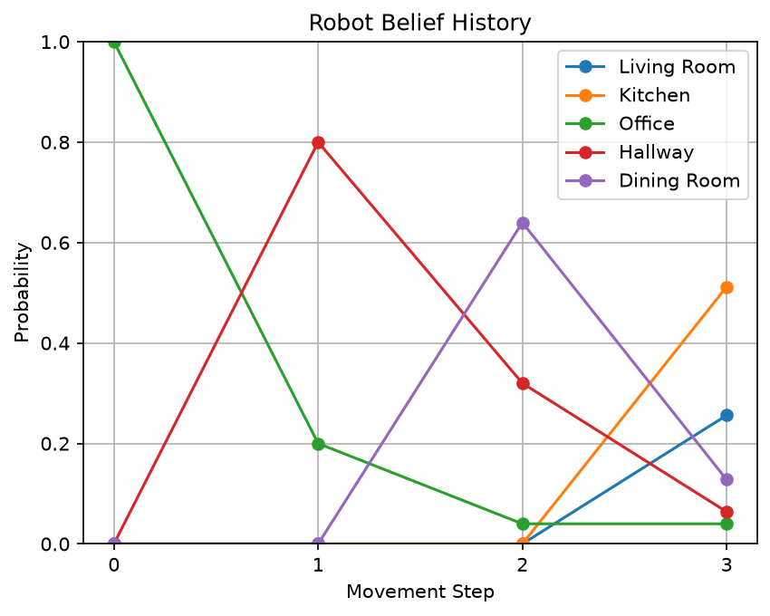
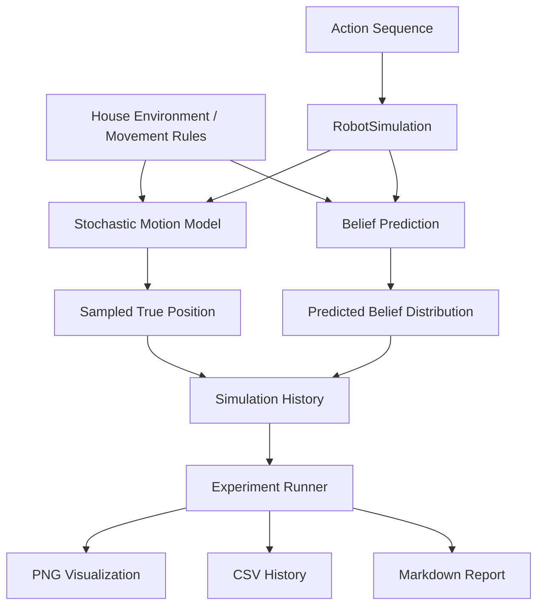

<div align="center">

# Robot Intelligence Lab

**Probabilistic Robot Motion · Markov State Estimation · Experiment Automation**

A modular Python simulation for modeling uncertain robot actions, predicting location probabilities, and generating reproducible experiment artifacts.


</div>

## Overview

**How can a robot estimate where it might be when its movements are uncertain?**

Robot Intelligence Lab addresses this question with a discrete, five-room simulation. Rather than assuming every motion command succeeds, it models multiple possible outcomes and maintains a **belief state**: a probability distribution over possible robot locations.

This Phase 1 implementation focuses on **motion prediction without sensor observations**. It combines probabilistic modeling, modular software design, automated tests, and an experiment pipeline that exports results for inspection.

### Engineering highlights

- **Stochastic motion:** A valid commanded move succeeds with probability **0.80** or leaves the robot in place with probability **0.20**.
- **Markov belief prediction:** Updates location probabilities using the law of total probability.
- **Two prediction implementations:** Explicit state transitions and transition-matrix multiplication.
- **Ground-truth separation:** Samples the robot's actual location independently of its estimated belief distribution.
- **Experiment automation:** Exports a belief plot, CSV simulation history, and Markdown experiment report.
- **Automated validation:** The supplied Phase 1 project snapshot reports **28 passing `unittest` tests**.

**Tech stack:** Python 3 · Matplotlib · Python standard library (`unittest`, `random`, `csv`, `pathlib`)

## Demo & Results

The sample experiment starts in **Office** and executes three commands:

```text
Initial location: Office
Actions: RIGHT → RIGHT → UP
```



*Belief-history visualization: each curve represents the predicted probability of occupying a room after successive actions. The estimator does not read the robot's sampled true position.*


### Example: One Motion Update

Assume the robot starts in `Office` with certainty:

$$
P(X_0 = \text{Office}) = 1
$$

After executing a valid `RIGHT` command, the motion model predicts the following belief distribution:

| Predicted Location | Probability |
|---|---:|
| Hallway | $0.80$ |
| Office | $0.20$ |
| All other rooms | $0.00$ |

The resulting probabilities satisfy the normalization condition:

$$
\sum_{x \in \mathcal{X}} b_1(x) = 0.80 + 0.20 = 1
$$

**Ground Truth vs. Belief:** The robot's actual next position is sampled probabilistically and may differ between runs. In contrast, the predicted belief distribution is computed from the transition model and remains deterministic for a fixed initial belief and action sequence.


### Generated Artifacts

Each experiment automatically generates three output files for visualization, analysis, and reproducibility.

| Artifact | Description |
|---|---|
| [`belief_history.png`](robot_lab/experiments/results/integrated_experiment/belief_history.png) | Visualizes the evolution of the robot's belief distribution across simulation steps. |
| [`simulation_history.csv`](robot_lab/experiments/results/integrated_experiment/simulation_history.csv) | Records executed actions, sampled ground-truth positions, and predicted belief probabilities. |
| [`experiment_001.md`](robot_lab/experiments/results/integrated_experiment/experiment_001.md) | Provides a structured Markdown report summarizing the experiment and its results. |

These artifacts enable inspection of the robot's probabilistic behavior and comparison between its **ground-truth trajectory** and **estimated belief distribution**.

## Technical Approach

### Discrete environment and motion model

The environment consists of five connected rooms: **Living Room, Kitchen, Office, Hallway, and Dining Room**. Supported commands are `LEFT`, `RIGHT`, `UP`, and `DOWN`. Commands that cannot move the robot beyond a room boundary leave it in the current room.


For valid moves, the motion model assigns a probability of $P(\text{move}) = 0.80$ to successfully executing the commanded transition and $P(\text{stay}) = 0.20$ to remaining in the current room.

### Markov belief prediction


Let $b_t(x)$ represent the probability of the robot being in state $x$ at time step $t$. The belief after executing action $a_t$ is predicted using:

$$
b_{t+1}(x') = \sum_{x \in \mathcal{X}} P(x' \mid x,a_t)\,b_t(x)
$$


Here, $P(x' \mid x,a_t)$ represents the probability of transitioning from room $x$ to room $x'$ after executing action $a_t$.

Using a row-vector belief and row-stochastic transition matrix, the same update is:

$$
\mathbf{b}_{t+1}=\mathbf{b}_{t}\mathbf{T}_{a_t}
$$

The project implements **both transition-based and matrix-based prediction**, providing two ways to compute the same probability update.

> **Key distinction:** The simulator maintains a sampled **ground-truth position** for evaluating behavior, while the estimator maintains a **probability distribution**. Belief prediction does not access ground truth.

## System Architecture



**Separation of responsibilities:** Environment rules define valid motion, the motion model samples the actual transition, belief modules perform probabilistic prediction, simulation coordinates each step, and experiment modules export results.

### Repository structure


```text
robot-intelligence-lab/
├── .gitignore                       # Git exclusion rules
├── README.md                        # Project documentation
├── pyproject.toml                   # Python project configuration
├── uv.lock                          # Dependency lockfile
├── main.py                          # Demo and experiment entry point
├── assets/                          # Project assets
├── data/                            # Example data and experiment inputs
├── robot_lab/
│   ├── worlds/
│   │   └── house.py                 # Five-room environment
│   ├── core/
│   │   ├── robot.py                 # Robot and sampled movement
│   │   └── simulation.py            # State, belief, and history management
│   ├── motion/
│   │   ├── movement_rules.py        # Allowed directional moves
│   │   ├── motion_model.py          # Stochastic movement probabilities
│   │   └── transition_matrix.py     # State transition matrices
│   ├── belief/
│   │   ├── belief_state.py          # Initial belief distribution
│   │   └── belief_update.py         # Belief prediction implementations
│   ├── visualization/
│   │   └── belief_plot.py           # Belief visualization
│   └── experiments/
│       ├── experiment_runner.py     # Experiment orchestration
│       ├── csv_export.py            # CSV history export
│       ├── report_generator.py      # Markdown report generation
│       └── results/                # Example experiment outputs
└── tests/                           # Automated unittest suite
```


## Installation & Usage

**Requirements:** Python 3 and Matplotlib. This is a software simulation; no physical robot or robotics middleware is required.

From the repository root, install the plotting dependency and run the demonstration:

```bash
python -m pip install matplotlib
python main.py
```

### Run an experiment programmatically

```python
from robot_lab.experiments.experiment_runner import run_experiment

result = run_experiment(
    actions=["RIGHT", "RIGHT", "UP"],
    output_folder="robot_lab/experiments/results/my_experiment",
)

print(result["csv_path"])
print(result["png_path"])
print(result["report_path"])
```

The experiment runner generates corresponding history, visualization, and report files in the requested output directory.

## Testing & Validation

Run the automated suite from the repository root:

```bash
python -m unittest discover -s tests -p "test_*.py" -v
```

**Reported Phase 1 snapshot result: `Ran 28 tests` — `OK`.**

Tests cover stochastic movement behavior, probability normalization, belief predictions, simulation history, visualization and export creation, and consistency between CSV and Markdown reports.

The reported test result applies to the supplied project snapshot; it is not a claim of exhaustive correctness or validation on robotic hardware.

## Limitations & Future Work

**Current scope:** The implemented system supports discrete-state **motion prediction only**. It does not yet incorporate sensor-based correction, autonomous planning, or continuous-state localization.

Planned extensions include:

- **Sensor-based localization:** Observation likelihoods and Bayesian measurement updates.
- **Decision-making:** Markov decision processes, rewards, and policy computation.
- **Continuous-state simulation:** 2D motion and Gaussian uncertainty.
- **Model learning:** Estimation of motion and sensor parameters from data.
